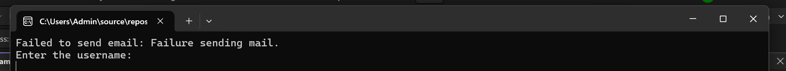
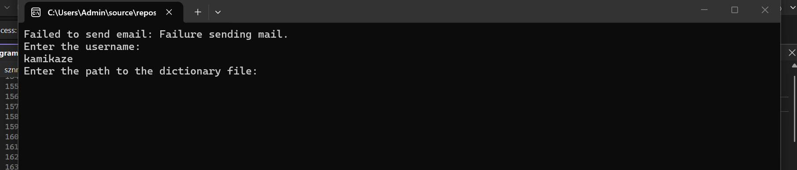
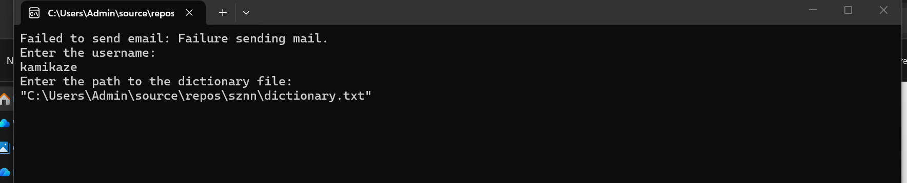

# CyberSafe Youth Initiative  
## Cybersecurity Lab Documentation: Password Security Awareness
## Terminal startup



*The terminal when the application first starts.*





*The next screen in the startup process.*
## 1. Lab overview

**CyberSafe Youth Initiative** is an early-stage cybersecurity research and education project focused on password security awareness and responsible online practices.

The initiative includes a technical prototype, **CyberSentinel**, intended to support learning about password security in a controlled environment. The project’s educational goal is to help participants understand why password practices matter and how to protect their digital identities.

This documentation covers the **cybersecurity lab** aspect of the initiative: its purpose, learning goals, safe scope, described prototype behavior, and possible future research. It is not a software architecture or installation guide.

## 2. Background and challenge

Digital services are widely used for communication, learning, work, and daily activities. As a result, people increasingly rely on accounts to protect personal and organizational information.

Weak or reused passwords, combined with limited security awareness, can increase the risk of account compromise. People may not know what makes a password risky, how to use password managers, or why multi-factor authentication is valuable.

Young people are active participants in the digital environment and can help promote safer online practices. This lab explores how a practical, ethical demonstration can make password-security concepts easier to understand.

## 3. Purpose of the lab

The lab is intended to support research and education by exploring password-security concepts in a controlled setting. Its objectives are to:

- Introduce common password-security risks.
- Encourage stronger authentication habits.
- Help learners understand how password testing should be conducted ethically.
- Explore how a small technical prototype can support cybersecurity education.
- Encourage responsible participation and collaboration in cybersecurity.

The project is **educational**, not intended to access accounts or systems without permission.

## 4. Project and prototype history

The project has developed through several stages:

1. **Initial cybersecurity concept**  
   The early project description considered a broad set of cybersecurity ideas, including password security, monitoring, and potential AI use.

2. **Password-security prototype**  
   The technical work was later described as a C# terminal-based prototype that reads password candidates from a text file and offers an option to use original entries or variations.

3. **Remote authentication testing described**  
   Earlier descriptions mentioned testing authentication against SSH or FTP services. This behavior has not been verified against the current repository. If present, it must be restricted to an isolated lab or a system for which explicit authorization has been granted.

4. **Education and research framing**  
   The work was presented as the **CyberSafe Youth Initiative — Password Security Awareness and Research Project**, emphasizing awareness, ethical testing, and youth participation.

5. **Future AI research**  
   AI-assisted analysis and recommendations were proposed as possible future directions. No AI capability has been confirmed as implemented.

## 5. What the prototype is described as doing

Based on the project description, the prototype has been described as being able to:

- Read candidate entries from a dictionary text file.
- Let a user choose whether to use original entries or generated variations.
- Test authentication against SSH or FTP services, if that functionality is present.
- Report outcomes or errors in the terminal.
- Potentially record results or send an email notification, if those features are implemented.

These are **described or proposed behaviors**, not independently verified features. Check the current source code and test results before marking any of them as implemented.

### Important distinction

A tool that tries candidate passwords against a remote service is performing **authentication testing**. That is different from an offline password-strength demonstration. Remote testing can affect real accounts and services, so it must only occur in a controlled, explicitly authorized environment.

## 6. Lab scope and safety boundaries

### In scope

- Learning about password security and authentication.
- Reviewing how password candidates are handled in a local, controlled exercise.
- Using fictional or test-only data.
- Testing only in an isolated environment with explicit authorization.
- Discussing defensive practices such as unique passwords, password managers, and multi-factor authentication.

### Out of scope

- Testing passwords against accounts, services, or networks without permission.
- Using real people’s credentials or personal data.
- Testing public-facing services or third-party systems.
- Presenting a successful authentication attempt as proof that a system is secure.
- Treating unverified tool output as a definitive security finding.

**Recommended project direction:** Keep demonstrations offline where possible. If the current prototype includes remote SSH or FTP authentication attempts, document that clearly, limit it to a dedicated lab, and consider replacing it with offline educational analysis.

## 7. Lab inputs and outputs

The exact terminal prompts and output depend on the current code and should be documented from a test run.

### Inputs described so far

| Input | Purpose | Status to verify |
|---|---|---|
| Username | Identifies the account name used in the prototype | Confirm whether the program requests it |
| Dictionary text file | Supplies candidate entries | Confirm file format, encoding, and error handling |
| Original-or-variation choice | Selects how candidates are processed | Confirm the available options and behavior |
| Connection details | May be needed if remote authentication testing is present | Verify what is requested; do not publish sensitive values |
| Email configuration | May be needed if notifications are implemented | Confirm whether this feature exists and how secrets are protected |

### Outputs described or proposed

| Output | What it may show | Status to verify |
|---|---|---|
| Terminal messages | Progress, completion, errors, or results | Capture the actual messages |
| Result or error records | Outcomes of processing or testing | Confirm whether files are written and what they contain |
| Email notifications | Possible notification of a reported result | Confirm implementation and data included |
| Educational recommendations | Possible future explanations or guidance | Planned unless present in the code |

Do not place real passwords, account details, network addresses, or secrets in documentation examples.

## 8. Safe illustrative code excerpts

The following examples show **safe, offline educational processing**. They are not copied from the repository and do not attempt to authenticate to any service.

### Example A: Read a local text file and count entries

```csharp
string[] entries = File.ReadAllLines(filePath);

int nonEmptyCount = entries.Count(line => !string.IsNullOrWhiteSpace(line));

Console.WriteLine($"Entries read: {entries.Length}");
Console.WriteLine($"Non-empty entries: {nonEmptyCount}");
```

This example reads a local file and reports basic counts. It does not display or transmit the entries, and it does not test them against an account or service.

### Example B: Report a privacy-conscious summary

```csharp
Console.WriteLine("Local review complete.");
Console.WriteLine($"Entries reviewed: {nonEmptyCount}");
Console.WriteLine("No passwords are displayed in this summary.");
```

A summary like this can support an educational exercise while avoiding unnecessary exposure of sensitive values. It should not claim to determine whether an account or system is secure.

## 9. What the lab checks—and what it does not

Based on the description available, the prototype may process candidate strings and report the result of an authentication attempt if remote testing is implemented.

There is no verified evidence that the current project:

- Detects network intrusions.
- Monitors users or systems for anomalous behavior.
- Determines whether a password has been exposed in a breach.
- Conducts a comprehensive password-strength audit.
- Provides AI-generated security recommendations.

Those capabilities should be described as future research unless they are present in the code and have been tested.

## 10. Learning outcomes

Participants completing a well-scoped version of this lab should be able to:

- Explain why weak or reused passwords can create risk.
- Identify safer account-protection habits.
- Distinguish offline password education from remote authentication testing.
- Explain why authorization and controlled environments matter in cybersecurity.
- Describe how tools can support learning without replacing security judgment.

## 11. Future research directions

Potential future work includes:

- Creating offline demonstrations that explain password-security concepts without contacting real services.
- Improving the clarity and privacy of lab results.
- Developing learning materials for students and community groups.
- Exploring AI-assisted explanations of security findings.
- Investigating authorized, defensive analysis of security events as a separate research direction.

### Possible role for AI

AI could eventually help present technical findings in more accessible language or organize information for a human reviewer. Any AI-generated output should be clearly identified as an interpretation, not a confirmed fact. It should be checked against the underlying evidence, and should not automatically make security decisions.

No AI model or AI feature has been confirmed as part of the current implementation.

## 12. Global collaboration and expected impact

Through opportunities such as the **World Internet Conference Global Youth Community**, the initiative aims to exchange ideas with young innovators and learn from different perspectives on cybersecurity and digital development.

Cybersecurity challenges cross borders. The project hopes to contribute to safer digital practices through knowledge sharing, responsible research, and greater youth participation in technology.

## 13. Documentation status labels

When describing the project in the repository, use these labels consistently:

- **Implemented:** Present in the code and tested for the stated use.
- **In development:** Actively being built or evaluated.
- **Planned:** A possible future direction.
- **Unverified:** Mentioned in project descriptions but not checked against the current code.

This distinction helps keep the lab documentation accurate as the project evolves.

## 14. Responsible-use statement

This lab is for education, research, and authorized testing only. Do not use the prototype to attempt access to another person’s account, service, device, or network without explicit permission. Use fictional or test-only data, follow applicable laws and policies, and avoid collecting or sharing sensitive information. This lab was conducted in a safe environment against my own Linux system. 

The prototype is an educational project, not a production security product or a substitute for professional security advice.
